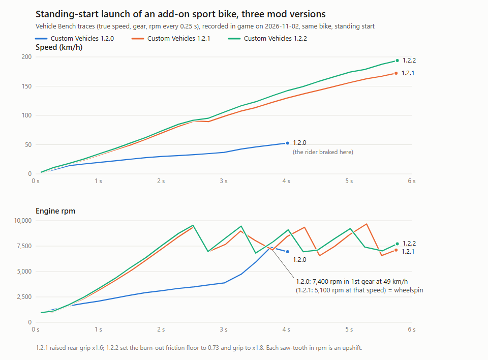
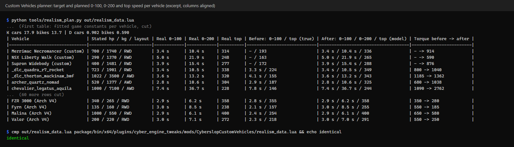

# Cyberslop Custom Vehicles + Vehicle Bench

Vehicle performance tuned from measurements, for Cyberpunk 2077: a bench logger times real acceleration and top speed in the game, fitting scripts turn those numbers into drivetrain values, and a small mod applies them. Single-player only.
Custom Vehicles 1.2.5 | Vehicle Bench 1.2.1 | Built on game version 2.31, small fixes on 2.5 | Status: 1.0.0 to 1.2.2 benched in game; 1.2.3 to 1.2.5 not yet play-tested

> This is an unofficial fan work and is not approved/endorsed by CD PROJEKT RED. No game files are included.

<p>


</p>

## The problem

A vehicle overhaul mod retunes the game's cars and bikes by record name. Add-on vehicles from other mods that were copied from a vanilla record before that overhaul ran still drive like stock, and add-on vehicles with their own engine have numbers that fit neither. On top of that, a vehicle's 0-100 km/h time and top speed cannot be read from the game's data: the drivetrain is simulated natively, and the speedometer shows speed multiplied by a curve, not the real speed.

## What I built

Three parts.

1. **Vehicle Bench** (302 lines of Lua): a logger that times 0-60, 0-100 and 0-200 km/h and top speed of the vehicle you drive, in true speed and in speedometer speed, and writes each run and a speed trace to CSV. It is off until you arm it.
2. **Fitting scripts** (`tools/`, Python): they fit the game's drivetrain model to the bench traces, fit a real-world acceleration model to published road-test figures, and plan gear bands, torque and drag for each vehicle so that it reaches what its own stated power and mass would give in reality.
3. **Custom Vehicles** (699 lines of Lua plus the generated data file): applies the plan at game start. It changes: engine torque, gear speed bands, torque multipliers and air resistance of 71 vehicle records at runtime, and points copied add-on vehicles at the tuned engine and drive model of their vanilla base. Nothing is written to disk except a log.

## How it works

- The mod waits until the vehicle overhaul it builds on has finished (that mod sets a marker when done) and gives up after 120 seconds if it never does.
- `CLONES`: add-on vehicles copied from a vanilla record get the tuned engine and drive-model records of that base.
- `SCALED`: add-on vehicles with their own engine keep their ride height, wheels and mass; gearbox, drag and suspension character come from a template car, with torque scaled by the power ratio.
- `REALISM`: every tuned vehicle gets the planned torque, gear bands and drag from `realism_data.lua`.
- `LIVE`: if another mod has re-pointed a vehicle to records of its own, the same values are written to the records the vehicle really uses.
- A record that does not exist (the add-on vehicle is not installed) is skipped and named in the log.
- `realism_data.lua` is generated by `tools/realism_plan.py`. It is not edited by hand.

```text
package/bin/x64/plugins/cyber_engine_tweaks/mods/
  CyberslopCustomVehicles/init.lua          the mod
  CyberslopCustomVehicles/realism_data.lua  generated plan for 71 vehicles
  CyberslopVehicleBench/init.lua            the bench logger
tools/                                      fitting and planning scripts
```

## Requirements

| Requirement | Version | Link |
|---|---|---|
| Cyberpunk 2077 | built on 2.31 | |
| Cyber Engine Tweaks | a build for your game version | [Nexus Mods, mod 107](https://www.nexusmods.com/cyberpunk2077/mods/107) |
| Cyber Vehicle Overhaul (for Custom Vehicles) | 2.1 | [Nexus Mods, mod 3016](https://www.nexusmods.com/cyberpunk2077/mods/3016) |
| Python 3 (only for the tools) | 3.11 used | |

Vehicle Bench needs only Cyber Engine Tweaks. The add-on vehicle mods named in the tables at the top of `init.lua` are optional: missing ones are skipped. Requirements are not bundled.

## Install

1. Install the requirements above.
2. Copy the `bin` folder from `package/` into the game folder. Copy only `CyberslopVehicleBench` if you want just the logger.
3. Start the game. Custom Vehicles writes what it applied to `CyberslopCustomVehicles.log` in its folder; in the CET console, `GetMod("CyberslopCustomVehicles").status()` prints a summary.

## Uninstall / roll back

1. Close the game.
2. Delete `bin\x64\plugins\cyber_engine_tweaks\mods\CyberslopCustomVehicles` and `...\CyberslopVehicleBench`.
3. Nothing else needs undoing: every change is made in memory when the game starts. Saves are not affected.

## Usage

**Bench a vehicle.** Bind "Vehicle Bench: arm / disarm" in CET's Bindings tab, or run `GetMod("CyberslopVehicleBench").arm()` in the console. Stop the car, floor it on a long straight road until top speed, brake to a stop. Each run is one line in `bench.csv`; `trace.csv` holds time, true speed, gear and rpm every 0.25 seconds. Do not use time dilation while testing.

**Re-plan.** The scripts in `tools/` read their inputs from a work folder (environment variable `VEHICLE_WORK`, default `tools/work`) and the game folder (`CP2077_DIR`). The inputs are dumps made from your own install by `vehicle_ui_specs.py` (the game's stated power, mass and drive layout per vehicle) and `cvoo_dump.py` (the overhaul mod's tuning tables); neither dump is included here. Then:

```text
python tools/vehicle_audit.py                      compare stated specs with what the tables give
python tools/realism_plan.py <path>/realism_data.lua   write the plan and the data file
python tools/realism_check.py                      check every vehicle against its target
```

**Console.** `GetMod("CyberslopCustomVehicles").bikeGrip(f)` and `.bikeShift(t)` change the bike rear grip factor and shift time for the session.

## Status

| Version | Result |
|---|---|
| Custom Vehicles 1.0.0 | Confirmed in game (2026-11-02). |
| 1.2.0, 1.2.1, 1.2.2 | Benched in game with Vehicle Bench; bike handling judged "much better" after the grip passes. |
| 1.2.3 | Not benched. |
| 1.2.4, 1.2.5 | Small fixes made on 2.5. Not run in game. |
| Planner | Re-running `realism_plan.py` on the original inputs reproduces the shipped `realism_data.lua` byte for byte (checked 2026-11-24). |
| Plan check | `realism_check.py` reports 71 vehicles, 3 off target, 1 with non-monotonic gear multipliers. |

## Compatibility

| Item | Status | Notes |
|---|---|---|
| Cyber Vehicle Overhaul 2.1 | required | The plan is keyed to its module names and records. |
| A mod that re-points owned vehicles to its own records | handled | The `LIVE` pass writes to the records in use. |
| Add-on vehicles not listed in the tables | untouched | Add them to the tables at the top of `init.lua`. |

## Known issues

- Custom Vehicles logs every applied preset at each game start, with no switch and no size limit. Delete `CyberslopCustomVehicles.log` from time to time.
- After a CET "Reload all mods", `bikeGrip(f)` has no base values until the game restarts.
- 16 vehicles with a top speed above about 340 km/h keep little headroom in top gear.
- `bench.csv` and `trace.csv` grow without limit while the bench is armed.

## Engineering notes

**Symptom.** After the first tuning pass, the add-on bikes spun their rear wheel on every launch and screamed against the rev limiter.

**Diagnosis.** The bench trace logs gear and rpm next to true speed four times a second. It showed rpm at the limiter while speed lagged, and rpm jumping after every upshift: wheelspin, not a gearing error. The bench also logs which records the vehicle really uses, and reading those gave the causes. The overhaul sets every bike's forward weight transfer to 0.01, and another installed mod lowers bike friction on asphalt, so a realistic launch force of about 10 m/s2 spins the rear. The add-on bikes also set their burn-out friction floor to 0.1 (the overhaul's bikes use 0.73, vanilla 0.4): once the rear slips it keeps 10 % of its grip and stays on the limiter.

**Fix.** 1.2.1 raised rear grip by a factor of 1.6. 1.2.2 set the burn-out friction floor of those bikes to 0.73, shortened their shift time and raised the grip factor to 1.8. Each change was benched before the next. One question stayed open: why one car launched cleanly on one gearbox layout and spun on another at a lower planned force.

**A second finding from measuring.** The first plan used assumed constants for the game's drivetrain model. Bench runs showed the real ones, so `bench_fit.py` now fits them from traces, and from 1.2.0 the plan uses measured constants.

**Rollback.** Every version was installed with a backup of the previous files. All changes are in memory, so removing the folder restores stock behaviour at the next start.

## Changelog

See [CHANGELOG.md](CHANGELOG.md).

## Credits and licence

Builds on Cyber Vehicle Overhaul; runs on Cyber Engine Tweaks. Neither is included here. Real-world reference figures in the fitting scripts are published road-test numbers.

MIT, see [LICENSE](LICENSE). The licence covers my code only. Game names and trademarks belong to their owners.

Built with AI assistance (Claude); designed, tested and maintained by me.
